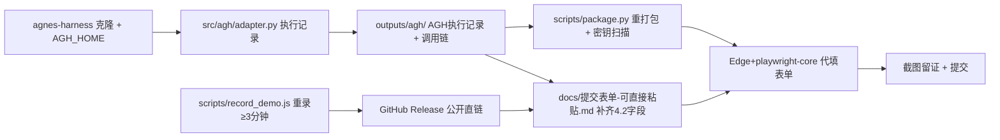

## 产品概述

按官网 4.2/4.3/3.1 条款，把「安巡 · 实验室安全应急处置 Agent」补齐为合规参赛提交材料，并用无头浏览器代填 hackathon 表单、由我点击提交。

## 核心功能

1. **AGH 真机接入与执行记录**：克隆 `AgnesAI-Labs/agnes-harness`，设 `AGH_HOME`，经 `src/agh/adapter.py` 跑通「任务规划 → 能力调用 → 反馈处理 → 结果验证」≥3 个连续步骤，产出可人工核查的 AGH 执行记录文件（满足硬条款 3.1/3.2）。
2. **演示视频合规化**：现有 2′09″ 不满足「3–5 分钟」，重录为 ≥3 分钟真机版（含字幕、无 Key），转 H.264；按用户选择推到 GitHub Release 生成公开直链，作为表单主链接（备用链接选填）。
3. **补齐 4.2 全部必填字段文案**：参考方向（多选）、问题来源与目标、AGH 作用、Agnes 模型名称/版本/环节/调用方式、数据/代码/仿真环境/API/设备接口、可运行作品（在线体验链接 + 代码仓库）、运行证据（AGH 执行记录 + ≥1 条工具/设备调用链 + 模型参与核心任务证据）、**正常/边界/失败三类测试样例**、成员声明、**≥1 条公开内容（平台 + 有效链接 + 截图 + 发布日期）**。
4. **重新打包**：加入新增证据文件（AGH 执行记录、三类测试样例、视频），`--scan-only` 密钥扫描通过后按 `本科生组-U126-大肥鱼脚香香-李家杰.zip` 命名重打包。
5. **浏览器代填并提交**：用系统 Edge + `playwright-core`（playwright-cli 不可用）驱动提交页；验证码由用户当场口述；填完（含 ZIP 上传 `setInputFiles`）截图留证后点击提交。

## 技术栈

- Python 3.8+ 标准库（既有项目零第三方依赖，保持不变）
- 浏览器自动化：`playwright-core@^1.64.0`（已在 `node_modules`）+ 系统 Edge（`C:\Program Files (x86)\Microsoft\Edge\Application\msedge.exe`），与 `scripts/record_demo.js` 同一套驱动方式
- 视频：既有 `scripts/record_demo.js`（Edge 无头录屏）+ `@ffmpeg-installer/ffmpeg` 转 H.264；直链走 GitHub Release
- AGH：`https://github.com/AgnesAI-Labs/agnes-harness`（已验证可达），接入点 `src/agh/adapter.py`

## 实施方案

采用「证据补齐 → 文案定稿 → 重打包 → 代填提交」四段式，全部复用既有脚本与适配层，不改动已验证的仿真/Agent/工具层。

**关键决策一：AGH 真机接入走 adapter 而非改业务代码**
`src/agh/adapter.py` 已是唯一接入点，`run.py agh` 已能生成接入配置。真机化只做三件事：`AGH_HOME` 指向克隆仓库、adapter 记录每一步「规划/调用/反馈/验证」结构化日志、落盘 `outputs/agh/` 执行记录。这样即使 AGH 运行时只支持只读加载，也能产出可核查记录；业务层零改动、回归风险最小。

**关键决策二：视频走「重录 ≥3 分钟 + GitHub Release 直链」**
赛事只收链接。用户已接受 GitHub 直链风险，因此主链接用 Release 附件直链（永久、免登录、评审期有效），并在文案中同时给出代码仓库与在线体验说明作为兜底；若 Release 直链被判定不合「视频平台」要求，可回退为 B 站（需用户账号）。

**关键决策三：代填链路用 playwright-core + Edge 自建脚本**
`playwright-cli` 实测未安装且需全局 npm 安装；改用项目内 `playwright-core` + 系统 Edge（已被 `record_demo.js` 验证可用）。流程：打开提交页 → 停登录步 → 用户口述验证码 → 逐项 `fill`/`select`/`check` → `setInputFiles` 上传 ZIP → 截图留证 → 点击提交。

**关键决策四：提交前双保险**
提交前先跑 `scripts/package.py --scan-only`（密钥扫描必须通过）+ `run.py selftest`；提交瞬间的页面截图存 `outputs/submit-proof/`。截止前可重复提交覆盖，故首次提交以「尽早占位」为原则，后续可迭代再交一版。

## 执行要点（防回归）

- **不碰业务代码**：`src/world.py`、`src/tools/`、`src/agent/`、`src/mcp/`、`src/server/` 本轮零改动；已验证的 14 步真机闭环与 2′09″ 视频同源 Trace 不受影响。
- **密钥零落盘**：全程只用环境变量 `AGNES_API_KEY`；录屏/截图前确认页面不显示 Key；打包前 `--scan-only` 必须输出「扫描通过」。
- **验证码边界**：只接受用户当场口述，不猜测、不绕过；登录态用同一浏览器上下文保持，避免中途掉线导致已填内容丢失。
- **长任务防卡**：视频录制与 AGH 克隆耗时较长，命令统一落盘日志（如 `outputs/*.log`）后读取，避免前台阻塞；录制 `--seconds` 设为 ≥200 以保证成片 ≥180 秒。
- **表单字段容错**：字段名称以实读 DOM 为准；若某字段为富文本或下拉多选，改用 `select`/`check`/`fill` 对应方式，填写后立即截图核对再提交。

## 架构设计

沿用既有分层：`run.py` 统一入口 → `src/agh/adapter.py`（AGH 接入与执行记录）→ `src/agent/loop.py`（决策）→ `src/tools/`（设备调用链）。本轮新增只在「证据产出」与「提交自动化」两侧：



## 目录结构

```
c:/Users/ZMJJK/CodeBuddy/20261013212202/
├── src/agh/adapter.py                 # [MODIFY] 真机化：记录「规划/调用/反馈/验证」结构化步骤，落盘 AGH 执行记录；AGH 不可用时给出明确失败提示而非静默
├── outputs/agh/                       # [NEW] AGH 执行记录（JSON/MD）+ 至少一条工具/设备调用链证据
├── scripts/record_demo.js             # [MODIFY] 录制时长参数默认 ≥200s，成片 ≥3 分钟；保持无 Key 显示
├── outputs/video/演示视频-安巡-实验室安全应急处置.mp4   # [MODIFY] 重录 ≥3 分钟真机版
├── docs/提交表单-可直接粘贴.md         # [MODIFY] 按 4.2 补齐全部字段文案（参考方向/问题来源目标/AGH作用/模型版本环节/接口/运行证据/三类测试样例/成员声明/公开内容/视频链接）
├── docs/提交检查清单.md               # [MODIFY] 回填新增证据路径、视频直链、待办勾选状态
├── scripts/fill_form.js               # [NEW] Edge+playwright-core 代填脚本：登录停等验证码→逐项填写→上传ZIP→截图→提交
├── outputs/submit-proof/              # [NEW] 提交前后页面截图留证
└── dist/本科生组-U126-大肥鱼脚香香-李家杰.zip   # [MODIFY] 含新增证据后重新打包（扫描通过）
```

未列出的 `src/world.py`、`src/agent/`、`src/tools/`、`src/mcp/`、`src/server/`、`tests/` 本轮不改动（三类测试样例复用 `tests/test_smoke.py` 既有断言 + 补充边界/失败样例说明，不改动断言）。

## Agent Extensions

### Skill

- **playwright-cli**
- 用途：提供浏览器自动化命令范式（open/goto/snapshot/fill/upload/screenshot），用于驱动 hackathon 提交页填写与上传 ZIP
- 预期产出：登录→逐项填写→文件上传→提交前的完整可复现操作序列；因本机未安装该 CLI，实际以项目内 `playwright-core` + 系统 Edge 按同一范式执行